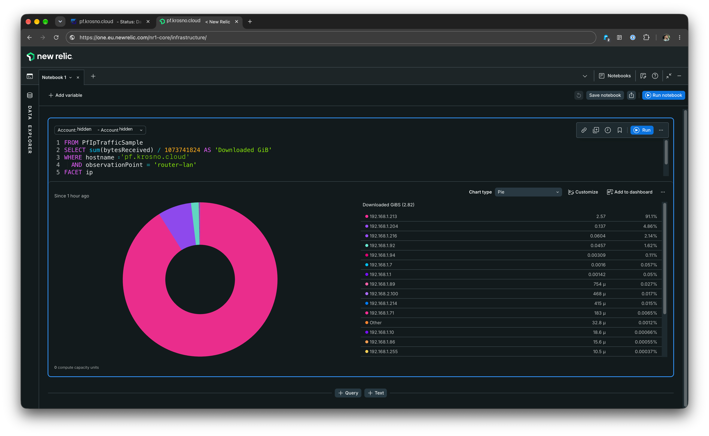
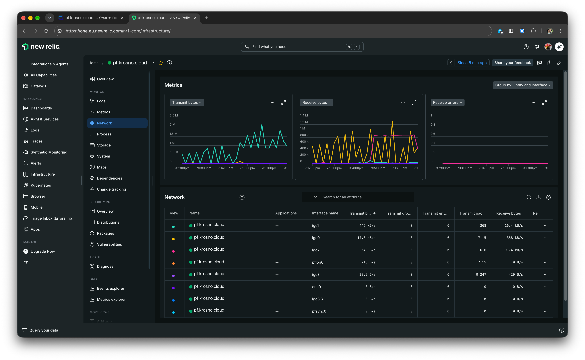

# New Relic Infrastructure Agent for pfSense / FreeBSD

**This is a home project, exercised in a home environment, not validated at large production scale.** It is an independent patch distribution, not an official New Relic or Netgate product or support channel. Use it at your own risk, especially on a router.

This repository packages FreeBSD changes to New Relic Infrastructure Agent 1.80.6 and an optional per-IP NetFlow collector. It contains the source patch and rebuild instructions rather than a full upstream fork. The optional bundled softflowd exporter observes one LAN interface before NAT; the project does not change firewall rules, NAT or routing.

## Supported scope

- Exercised on pfSense 2.9 / FreeBSD 16 amd64; the package ABI is `FreeBSD:16:amd64`. Other releases and architectures are not validated.
- Release `v1.80.6-freebsd.2` uses a generic amd64 CPU baseline without an AVX requirement. Use the corrected package version `1.80.6_2`; the earlier `_1` build could fail with an illegal instruction on a Celeron N4000.
- FreeBSD support does not include Linux container monitoring or Fluent Bit log forwarding. Do not assume all upstream Linux features work here.
- Per-IP collection is opt-in. Monitor capture CPU, packet loss, collector health and New Relic ingest cost. Exported flow counters are not a billing-grade traffic meter.

## Screenshots

Account identifiers and host labels are anonymized.





## Install

Download the recommended [`.pkg` for v1.80.6-freebsd.2](https://github.com/lukaszciechanowicz/newrelic-infrastructure-agent-pfsense/releases/download/v1.80.6-freebsd.2/newrelic-infra-freebsd-1.80.6_2.pkg). The [release page](https://github.com/lukaszciechanowicz/newrelic-infrastructure-agent-pfsense/releases/tag/v1.80.6-freebsd.2) also has checksums, an install-tree archive and standalone agent binaries. The archive/binaries are for manual use; the package manages configuration and rc services.

Check the OS/ABI before installing. Keep a router configuration backup and local recovery access. In a **root `sh` shell**, with the downloaded package in the current directory:

```sh
freebsd-version
pkg config ABI
sha256 newrelic-infra-freebsd-1.80.6_2.pkg
pkg add ./newrelic-infra-freebsd-1.80.6_2.pkg
```

Compare the hash with the release's `SHA256SUMS` entry before `pkg add`. The package SHA-256 is `d90bd8e4459eed0d8d8023dcda4a7a01723e0429acc83eaa955507e9890e67b1`.

## Configure with per-IP logging

The [complete example configuration](examples/newrelic-infra.yml) enables per-IP collection and the local status server. Its license key is deliberately fake and will not send data. Replace it with your New Relic **ingest license key**, not an `NRAK` user/API key. The backend region is derived from that key, including EU.

Replace the example CIDRs with your actual client subnets and choose the OS name of one internal pre-NAT interface. `YOUR_LAN_INTERFACE` below is a placeholder, not a pfSense display label. Keep the UDP listener on loopback.

The package creates `/usr/local/etc/newrelic-infra.yml` only if absent. Back up existing settings privately, then merge the example into that file; do not overwrite a live configuration blindly. Never paste a real key into an issue or shell command.

```sh
vi /usr/local/etc/newrelic-infra.yml
chown root:wheel /usr/local/etc/newrelic-infra.yml
chmod 600 /usr/local/etc/newrelic-infra.yml
sysrc -f /etc/rc.conf.local newrelic_infra_enable=YES
sysrc -f /etc/rc.conf.local newrelic_netflow_enable=YES \
  newrelic_netflow_interface=YOUR_LAN_INTERFACE
/usr/local/etc/rc.d/newrelic-infra.sh start
/usr/local/etc/rc.d/newrelic-netflow-exporter.sh start
```

Use `restart` instead of `start` for a service that is already running after changing its configuration. Enabling the collector alone is not enough: the exporter must also be enabled and running.

Generate traffic from a client across the selected interface. Check `http://localhost:8003/v1/status/errors`, exporter statistics, and `PfFlowCollectorSample`/`PfIpTrafficSample` in the account receiving your ingest key. Allow for flow expiry, the 15-second reporting window and backend ingest delay. See the guide below for exact commands and queries.

## Optional per-IP traffic

Here, “IP logging” means per-IP byte and packet counters in New Relic, not packet payload or DNS query logging. See [setup, verification, queries and troubleshooting](docs/PER_IP.md). Capture a single internal pre-NAT interface to retain client addresses. `tracked_cidrs` filters reported endpoints; it does not capture additional interfaces.

## Source and contributions

[Build instructions](docs/BUILD.md) explain how to recreate the source from the pinned upstream commit and `patches/freebsd-netflow.patch`, then build the packages. See [CONTRIBUTING.md](CONTRIBUTING.md), [SECURITY.md](SECURITY.md) and [CHANGELOG.md](CHANGELOG.md).

Project-maintained changes and documentation are Apache-2.0 licensed; commercial use is allowed subject to the license terms. Upstream and third-party licenses remain in effect. See [LICENSE](LICENSE), [NOTICE](NOTICE) and [THIRD_PARTY_NOTICES.md](THIRD_PARTY_NOTICES.md).
